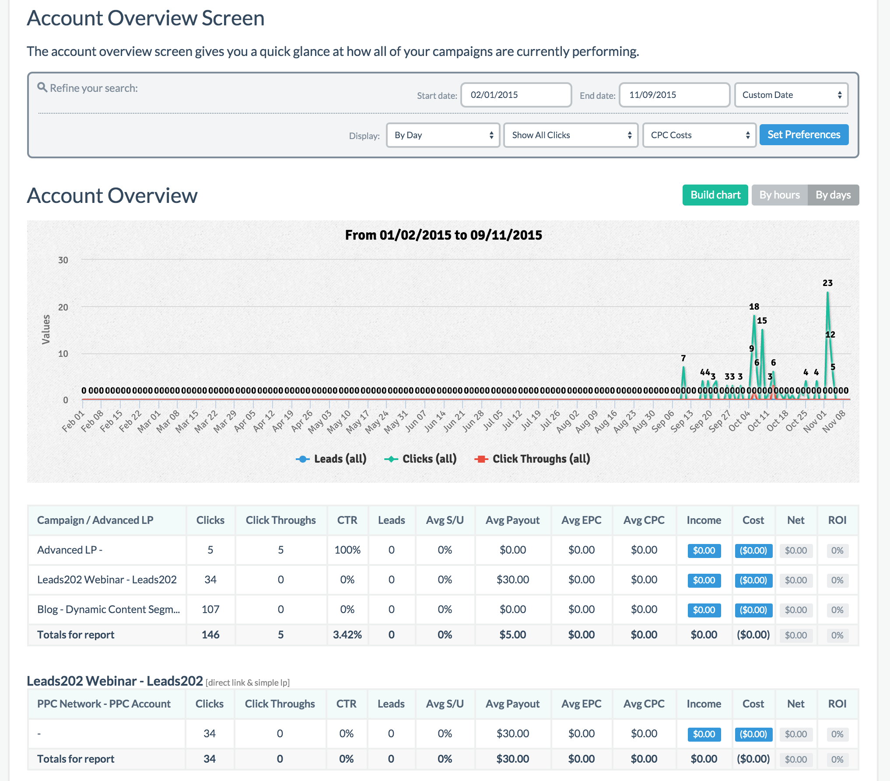
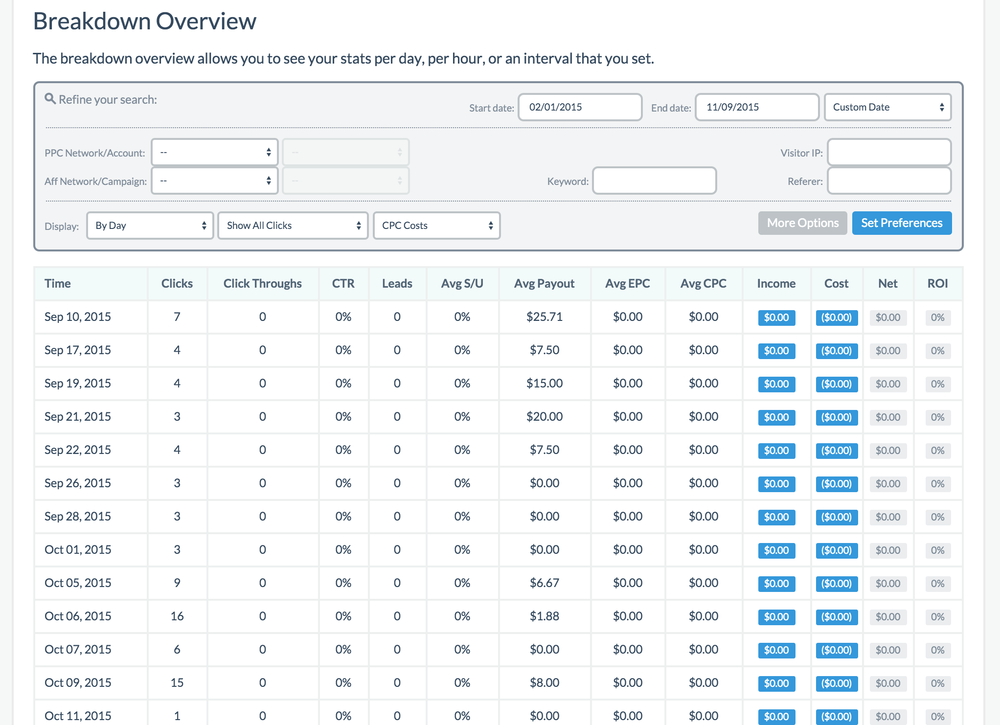
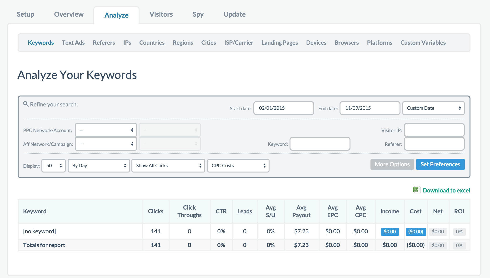
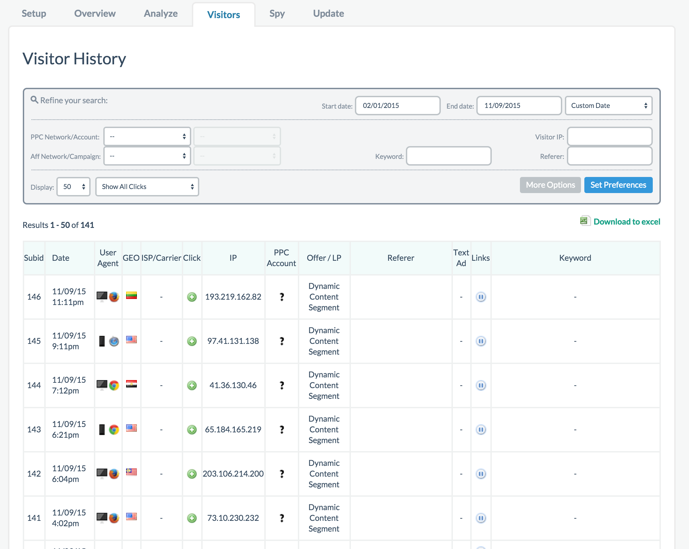
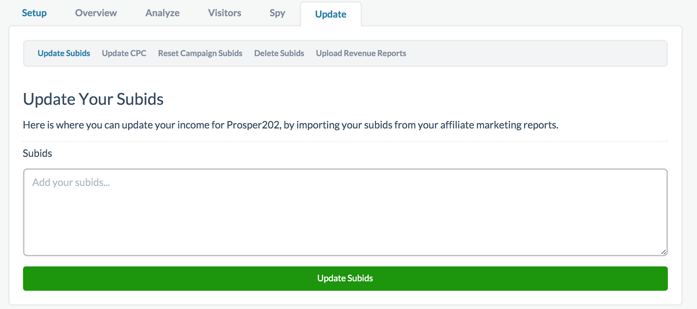

# Reporting

We're going to do a quick rundown of all the reporting available in this section. Please feel free to explore Prosper202 to get a better understanding of what you are looking at beyond what is written here.

## Overview

Overview in general gives you a bird’s-eye view of your overall campaign performance. Here we'll go over the various sub-sections under Overview.

**Campaign Overview**

By default, when you click on your Prosper202 CS link, the first screen you see is the general overview tab, specifically on Campaign Overview, with a general breakdown of your overall campaign performance. This screen gives you a general look over how all your campaigns are doing.

## Breakdown Overview

Next we have the breakdown overview section which gives you a overall daily breakdown of your campaigns' performance. You have some filtering capabilities here but this is a good way to see a quick day to day breakdown.

Each row is one hour, day, month or year of the calendar: 7 September and 7 October are two rows, and so is 3 pm on two different days. (A row used to be the 7th of every month in the window, or 3 pm of every day.)

## Day Parting and Week Parting

The next two sections allow you to see hourly performance (day parting) or which day of the week your campaign is performing best (week parting). This is useful for a granular level look at how your campaign is performing and great if you want further control over time on the specifics of when you want your campaign to run efficiently.

Hours, weekdays and days on every report page are your account's: the time zone in Personal Settings, on each side of a daylight-saving change, and to the minute in a zone such as India's (+05:30). Day Parting and Week Parting show the same figures as `GET /reports/daypart` and `/reports/weekpart` (and `p202 report daypart`/`weekpart`) for the same window. They used to use your zone's offset on the day you looked, rounded to a whole hour, for the whole window.

**Group Overview**

The last section in Overview warrants its own section in this guide so please refer to the guide section on Group Overview.

## Analyze

The analyze tab and its numerous sub-navigation options gives you a quick glance at the various types of performance based on which option you are looking at. Users often confuse this with specific options they are looking for when they can't find specific stats they want. If you are in the Analyze area and are unable to find specific stats you want, try Group Overview.

## Visitor and Spy Views

The spy view is a live time feed of all your clicks coming in. It shows a limited number of feeds and refreshes constantly. If you want to go through your click history, that’s what the visitor tab is for. They are essentially the same except visitor is your history log with no real time update and spy view is your real time feed of the past 24 hours worth of clicks without the history log.

A click with conversions shows how many on its row ("3 conversions"). Clicking
it opens the click's breakdown: every conversion recorded on it — the ones
that count toward its value and the ones that do not, with the reason (a later
conversion replaced it, it was deleted, it is tracked but not paid) — with
what produced each one (a postback, a goal and its version, an upload, the
API) and its transaction id, adding up to the click's value.

## Update

Finally you have the update tab. Update allows you to update various specifics such as manual uploading of converted SubIDs, deleting SubIDs if you want to clear away specific ones or campaigns, updating CPC, and so on.

These various steps are fairly self-explanatory and allows you more finite control over your campaigns. 

If you require further assistance or are confused by anything listed here, please subscribe to one of our support plans for further help.

## Large date ranges

A large date range can require reading many click rows, even when the report
returns only a few groups. The number of rows displayed does not describe the
amount of database work.

The region, ISP, browser and platform choices on Overview-family pages load
when Advanced is expanded, after the report request finishes. They are requested
one at a time; collapsing Advanced pauses choices that have not started.
An active filter keeps its label before the other choices load. If a choices
request fails, the report and selection stay available with a retry button.

When Memcached is available, requested choice lists are cached for five minutes
after loading. Entries are separated by database, account, exact date window,
filter and limit. New values can take a few minutes to appear; a selected value
outside the cached list is still looked up by ID. A cache miss reads the matching
clicks, grouping values before resolving labels. A cache outage falls back to
the database.

Report totals are calculated separately and are not cached by this change.
Improving dropdown loading does not establish that a full-year report will
complete within the web server's timeout.

Breakdown, Day Parting, Week Parting and Overview charts first combine matching clicks into UTC hours when the account's
timezone has whole-hour offsets and transitions, then calculate the local calendar
groups and their metrics. Account, date and click filters apply before that step.
Zones with sub-hour offsets or transitions retain the per-click calculation so
local midnight and daylight-saving boundaries remain accurate. This reduces
date-formatting work but still reads the matching click rows; runtime depends
on the selected range, database cache and storage.

Account Overview builds one connection-local temporary aggregate for its tables,
then resolves campaign, landing-page and traffic-source labels from those sums.
The chart is calculated separately. The temporary table lasts for this request
only and is dropped afterward. If the database account cannot create temporary
tables, the tables use individual aggregate queries instead. No database grants
or configuration changes are required to use that fallback.

Analyze reports count their final name groups in the paginated query rather than
scanning the clicks again for a normal page. An out-of-range page may still need
a separate count. Reports with a small set of dimension IDs aggregate before
label joins; keywords, referers and IPs keep their raw grouping path. Duplicate
names and missing labels retain the report's existing grouping behavior.

Analyze's region and ISP name suggestions load when Advanced opens and use the
same five-minute cache policy. They have separate entries from Overview's ID
choices. Typed filters are resolved against the name dictionaries; only an
ambiguous name needs click usage to select an ID within the account and window.

Group Overview aggregates before label joins for suitable grouping combinations.
Click-level conversion details and potentially unique dimensions retain their
raw path. Custom Variables uses a bounded dictionary-size probe to choose between
aggregate and raw plans; that probe never limits which values the report returns.
Rotator Breakdown still reads raw clicks and rotator records, aggregating before
the ownership lookup. Spy skips its unused total count; the paginated Visitors
log retains its count. These changes cover the PPC report families, rather than
LTV or mobile-app attribution reporting.

An HTTP 504 means the gateway timed out waiting for the report. It does not
establish that the session expired. Try a shorter range and capture the active
query if the full range continues to time out.

For a slow request, capture its active SQL and execution plan while it is
loading. Check PHP-FPM worker saturation and the Apache error log for 504
timeouts. Capture the query running at the timeout to distinguish optional
filter loading from the report calculations.
