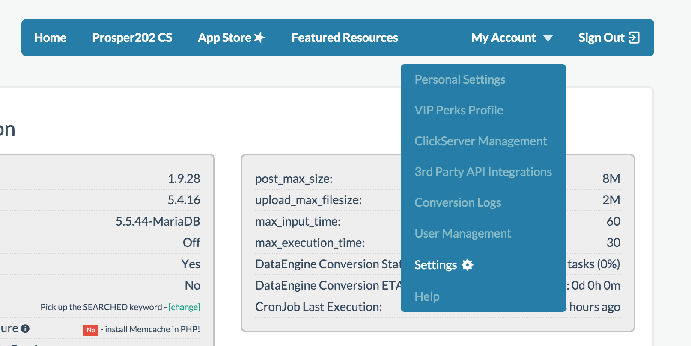
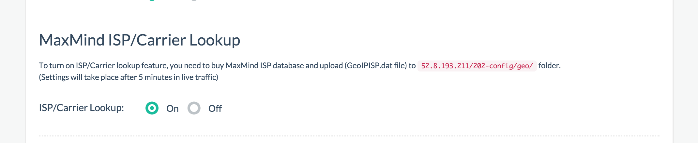

# IP and ISP DB Integration

## Keeping the GeoLite2 City database current

Every visitor's country, region and city come from the GeoLite2 City database
in `202-config/geo/GeoLite2-City.mmdb`: the geo reports, the rotator's country
and region rules, and privacy for European traffic (`eu`) all read it. The
copy that ships with Prosper202 was built by MaxMind on 2018-07-03. Address
blocks handed out or moved since then are not in it, so their visitors read as
unplaced (under privacy `eu` an unplaced visitor is treated as possibly
European, and masked) or in the wrong country.

MaxMind publishes a new GeoLite2 City database every Tuesday and Friday, free,
to anyone with a GeoLite account. To have this install download it weekly:

1. Sign up for a free GeoLite account at
   [maxmind.com/en/geolite2/signup](https://www.maxmind.com/en/geolite2/signup).
2. On your MaxMind account page, note your **Account ID**, then open **Manage
   License Keys** and make a licence key. MaxMind shows the key once: copy it.
3. In Prosper202, open **Account › Settings**, find the **GeoIP database**
   panel, enter the account ID and the licence key, and **Save**. Both are
   stored in the install's database and never shown again; an empty box keeps
   what is stored.
4. Press **Refresh now** to download the current database at once, or leave it
   to the cron job, which refreshes within the hour and then weekly.

The panel shows the installed database's build date and age, read from the file
itself, and how the last refresh ended. `GET /api/v3/system/info` and
`p202 system info` show the same (`geoip_database`, `geoip_refresh`), and
`GET /api/v3/system/health` and `202-cronjobs/health.php` add a warning once the
database is more than 30 days old, or is missing or unreadable.

What a refresh does:

- It asks MaxMind for the SHA-256 of the current archive first. When that is the
  archive already installed, it stops: one small request a week.
- Otherwise it downloads the archive (tens of megabytes) into
  `202-config/geo/`, checks its SHA-256 against MaxMind's, unpacks
  `GeoLite2-City.mmdb`, checks that it opens as a GeoLite2 City database, answers
  lookups, and was built after the installed one, and only then renames it over
  the installed file. The file it replaced is kept beside it as
  `GeoLite2-City.mmdb.previous`.
- Every download goes through the same outbound guard as the webhooks: https
  only, to public addresses only, pinned to the address it checked, never
  through a proxy. A server that can reach the internet only through a proxy
  cannot refresh.
- A refresh that fails leaves the installed database as it was, logs why in the
  server's error log, and shows the reason in the panel. The cron job tries
  again a day later; MaxMind allows 30 GeoLite downloads a day.

The user the cron job and the web server run as needs write access to
`202-config/geo/`, or every refresh fails saying so. On a container deployment,
a redeploy puts back the image's copy; the cron job notices that the file is not
the one it installed and refreshes it within the hour.

Without an account nothing is downloaded, and the shipped 2018 database stays in
use. The panel and the health probes say how old it is.

This product includes GeoLite2 Data created by MaxMind, available from
[https://www.maxmind.com](https://www.maxmind.com).

## IP and ISP Database

Prosper202 requires the Maxmind IP and ISP Database in order to report the user's IP and ISP information, including the country maps you often see in sample screenshots. We do not include this in the free download since this is a paid database service provided by a third party company. Unfortunately we do not have this sort of data ourselves but we highly recommend Maxmind as we use their services ourselves.

To purchase the MaxMind IP and ISP Database, please go to: 
**[https://www.maxmind.com/en/geoip2-isp-database](https://www.maxmind.com/en/geoip2-isp-database?rId=tracking202)**

Once you have purchased this, you can follow the steps below to set it up.

## Setting Up ISP Database

Once you have purchased your MaxMind ISP Database, please upload the purchased file (**GeoIPISP.dat** file) to your **202-config/geo/** folder on your Prosper202 server. Once you've done that, go to your My Account > Settings inside of your Prosper202 install. 

Once there, scroll down to "MaxMind ISP/Carrier Lookup" and activate this feature by turning it on.

Once you've completed the steps above, please wait 5 to 10 minutes after live traffic has been going through the system for it to be implemented.