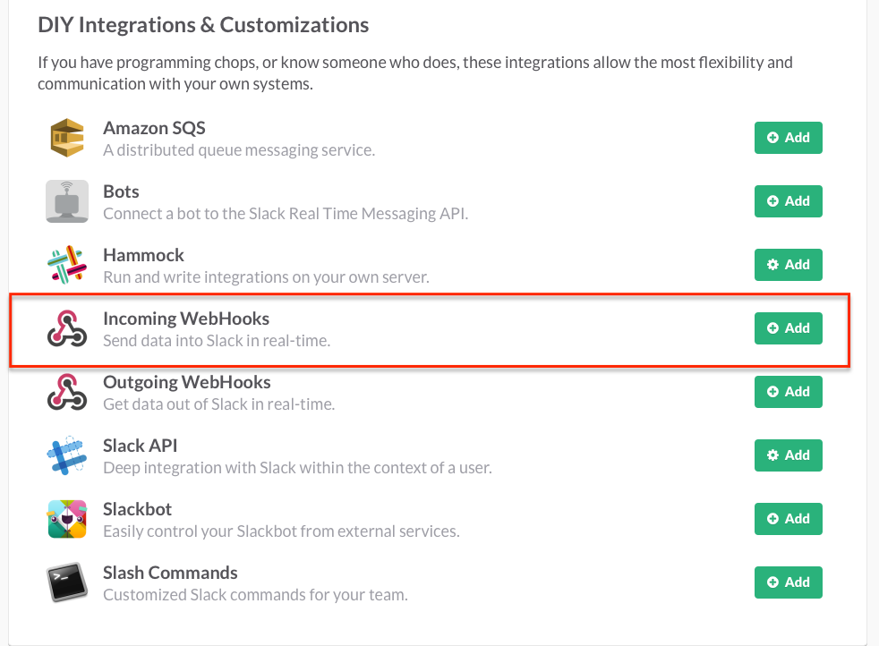
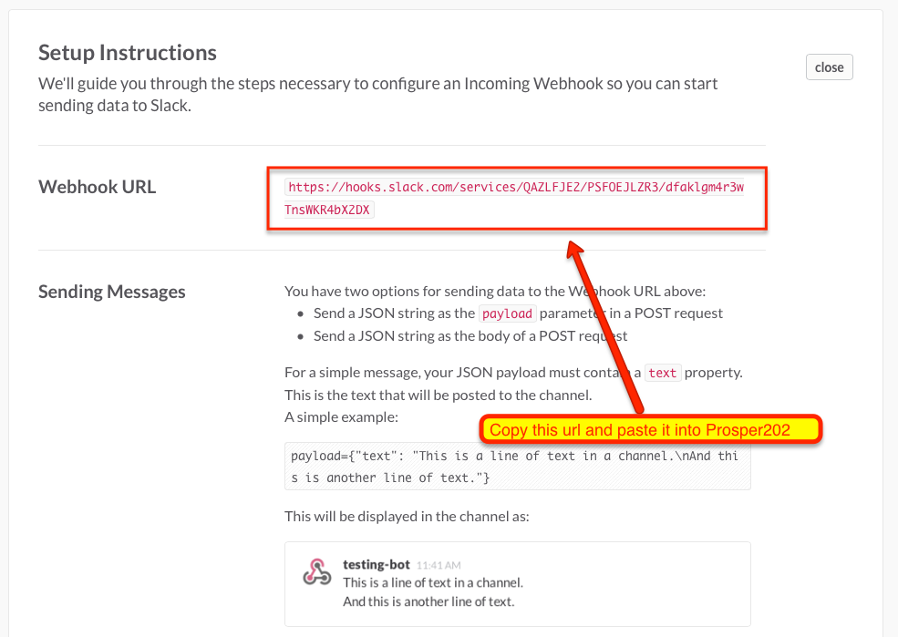
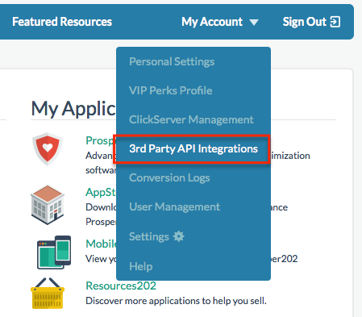
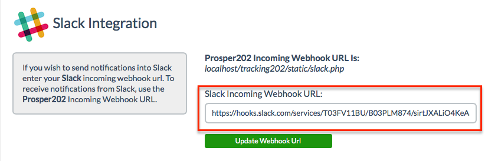
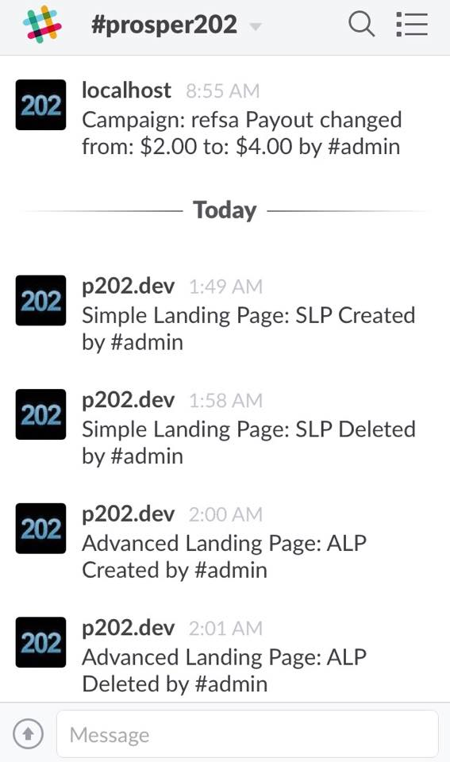

# 3rd Party Integrations

Currently inside your Prosper202 Install, we support a number of 3rd party integrations available to you. Below are some of the integrations you will find:

## Direct Network Integration

Direct Network Integration allows you to quickly find and setup offers directly inside of Prosper202 without any manual work. You can review the section on Direct Network Integrations for more details about this. [Click here to go there now](10-direct-network-integrations-dni.md).

Each user's networks are their own: My Account › 3rd Party API Integrations lists the networks the signed-in user added, and no one else's. A network's API key is never shown once it is saved; the list says that a key is saved and, for a key of 12 characters or more, its last four characters. To change a network, choose Edit: leave New API key empty to keep the saved key, or paste a new one to replace it. Moving the integration to a different network needs that network's key.

## Clickbank Sales Notification

Clickbank doesn't support Postback or custom conversion pixels, so to get real-time reporting of sales you can setup our Clickbank Sales Notification integration.

**Video:** [Setting Up Prosper202 and Clickbank Instant Notification](https://www.youtube.com/watch?v=M6zo3XuExL0&feature=youtu.be)

## PayKickstart

For a **vendor** selling through PayKickstart: Prosper202 records each sale and
rebill of your product on the click that sent the buyer, and a refund reverses
the sale, from PayKickstart's product IPN. Under **Account › API integrations ›
PayKickstart**:

1. Make each campaign's offer URL its PayKickstart checkout link with
   `subid=[[subid]]` added, such as
   `https://app.paykickstart.com/checkout/123?subid=[[subid]]`. A tracker fills
   `[[subid]]` with the click id, and PayKickstart sends it back in the IPN as
   `custom_subid`. For a subscription, set the campaign's **When a click
   converts more than once** (under Advanced) to **Add them up**: with **Keep
   the latest**, each rebill replaces the click's value rather than adding to
   it.
2. In PayKickstart, paste the page's IPN URL
   (`https://<your tracking domain>/tracking202/static/paykickstart.php`) into
   the **IPN Integration** tab of each product.
3. Store the **IPN secret key** of each PayKickstart campaign on the page (every
   campaign has its own, in its settings). Prosper202 verifies each IPN's
   `hash` with the stored keys, and the account whose key verifies it is the
   one it records for (a deleted account's keys verify nothing); an IPN no
   stored key verifies is refused. The keys are
   never shown back: the page lists their last four characters, and the API
   (`PUT /users/{id}/preferences`, `p202 user prefs update
   --paykickstart-ipn-secret-keys`) how many are stored.

What each IPN does, and what PayKickstart's IPN log shows for it:

| IPN | Prosper202 | Status |
| --- | ---------- | ------ |
| `sales` (a first payment or a rebill) | a conversion on the click, source `paykickstart`, under its `transaction_id`, worth its `amount` | `200 recorded` |
| the same `sales` again | nothing; a retry stating another amount is refused, and so is a sale whose refund is on file, naming the reversal to delete if the refund was undone | `200 duplicate` / `409` |
| `refund` | a reversal of the sale its `transaction_id` names, by its `amount` (the whole sale when it carries none or 0); a sale is reversed once | `200 reversed`, `404` when no such sale is on the click |
| a `refund` of a sale already reversed | nothing; a refund that takes back another amount than the one on file is refused, naming both: a full refund after a partial one says how much is still credited. Once that reversal is deleted, a later refund reverses the sale again; the deleted one's own refund, sent again unchanged, changes nothing | `200 duplicate` / `409` |
| test mode (`mode=test`) | nothing | `200 test` |
| `subscription-payment` and every other event | nothing (`sales` already counts every payment) | `200 ignored` |
| a sale whose checkout carried no subid | nothing: no click to credit | `200 no_click` |
| a `custom_subid` that is not a click of the account | nothing | `404` |
| a hash no stored key verifies | nothing | `403` |
| a malformed field (an amount such as `1,000`, `custom_subid=[[subid]]`, a `transaction_time` that is not a Unix time) | nothing | `400`, naming the field |
| an IPN that arrives while the database's upgrade has not run | nothing | `503`, naming the upgrade |
| an IPN that could not be recorded just now | nothing that a retry would double: a transaction id is recorded once | `500` |

A sale or refund is dated by its `transaction_time`, so one PayKickstart sends
again days later still falls on the day it happened; without one, it is
dated when it arrives. A time before the click (for a refund, before its
sale) is dated at the click (the sale), and one ahead of this server's
clock at its arrival; the answer says so. Reports by click day (`p202
report`) are unchanged by this: they count a conversion on its click's day.

Each IPN is logged in the server's error log in one line: the outcome, the
event, the click, the transaction and the account, never a key or the
buyer's details. Use an `https://` IPN URL: PayKickstart's signature covers the
values of an IPN but not which field each one is in, so whoever holds a signed
IPN can move its values between fields.

For an **affiliate** promoting PayKickstart products: PayKickstart's Affiliate
IPN cannot update conversions. It carries no click (PayKickstart allows no
custom variables in it, and the `tid` on your affiliate link shows only in
your PayKickstart account) and it is not signed. Leave the IPN URL out of the
Affiliate IPN setting; if you have it there, Prosper202 answers it `415`,
saying so.

## JVZoo

Prosper202 records each JVZoo sale and rebill on the click that sent the
buyer, and a refund or chargeback takes it back, from JVZoo's JVZIPN. It works
for an affiliate promoting a JVZoo product and for a vendor selling one; the
two have their own URL under **Account › API integrations › JVZoo**, because
the click comes from a different field for each.

For an **affiliate**:

1. Make the campaign's offer URL your JVZoo affiliate link with
   `?tid=[[subid]]` added, such as
   `https://www.jvzoo.com/c/12345/67890/?tid=[[subid]]`. A tracker fills
   `[[subid]]` with the click id, and JVZoo sends the tid back in the
   notification as `caffitid`.
2. In JVZoo, under **Affiliates › Approved Products**, open the product's
   **Integrations** and paste the page's **Affiliate IPN URL**
   (`https://<your tracking domain>/tracking202/static/jvzoo.php?role=affiliate`)
   into **Affiliate IPN**.

For a **vendor**:

1. Make the campaign's offer URL your product's JVZoo buy link with
   `?subid=[[subid]]` added at its end, and send buyers to it through the
   tracker (or a landing page's outbound link). JVZoo sends the buy link's
   variables back in the notification as `cvendthru`, and `subid` is the click.
2. In JVZoo, edit the product and, under **Advanced Settings**, choose
   **JVZIPN v1** and paste the page's **Vendor JVZIPN URL**
   (`https://<your tracking domain>/tracking202/static/jvzoo.php?role=vendor`)
   as its JVZIPN URL. Not the v2 URL: JVZIPN v2's `cverify` covers five fields
   and neither the amount nor the tid, so Prosper202 answers it `415`.

Either way, store your **JVZIPN secret key** on the page (JVZoo shows it under
**My Account › Account Details › Seller Settings**; one JVZoo account has one,
for both roles). Prosper202 checks each notification's `cverify` with the
stored keys, and the account whose key verifies it is the one it records for.
The vendor URL never reads `caffitid`, which is whatever tid an affiliate
chose, and the affiliate URL never reads `cvendthru`, which is the vendor's.
For a subscription, set the campaign's **When a click converts more than
once** (under Advanced) to **Add them up**, so each rebill adds to the sale.

What each notification does, and the status JVZoo sees (anything but `200`
is sent again every hour for 72 hours):

| `ctransaction` | Prosper202 | Status |
| -------------- | ---------- | ------ |
| `SALE`, `BILL` (a rebill, under its own receipt) | a conversion on the click, source `jvzoo`, under its `ctransreceipt`, worth its `ctransamount` (what JVZoo pays you: an affiliate's commission, a vendor's share) | `200 recorded` |
| the same `SALE` again | nothing; one stating another amount is refused | `200 duplicate` / `409` |
| `RFND`, `CGBK`, `INSF` (an eCheck chargeback) | a reversal of the whole sale its `ctransreceipt` names (JVZoo refunds a payment whole); a sale is reversed once, so a chargeback after a refund changes nothing | `200 reversed` / `200 duplicate`, `404` when no such sale is on the click |
| a `SALE` again after its refund (JVZoo's way of undoing a refund) | nothing: the answer names the reversal; delete it (`p202 conversion delete <id>`) to count the sale again. A refund sent after that reverses the sale again; the first refund sent again unchanged is a retry and changes nothing | `409` |
| `CANCEL-REBILL`, `UNCANCEL-REBILL` | nothing | `200 ignored` |
| `TEST` | nothing | `200 test` |
| a notification with no click (no tid, a tid that is not a click id, no `subid` in `cvendthru`) | nothing | `200 no_click` |
| a click that is not one of the account's | nothing | `404` |
| a `cverify` no stored key verifies | nothing | `403` |
| a malformed field (a `ctranstime` that is not a Unix time among them), a field JVZIPN v1 does not post, a URL with no `?role=` | nothing | `400`, naming it |
| a notification that arrives while the database's upgrade has not run | nothing | `503`, naming the upgrade |

A few things JVZoo's documentation leaves to the receiver:

- **Amounts.** JVZoo's field table calls `ctransamount` pennies
  (`1000` = $10.00) while its sample and its notifications state dollars
  (`10.00`). Prosper202 reads a decimal such as `47.00` as dollars and refuses
  a whole number such as `1000`, rather than guess which it is. JVZIPN states
  no currency: the amount is recorded in the account's.
- **Dates.** JVZoo resends an unanswered notification every hour for 72 hours,
  so a conversion or reversal is dated by `ctranstime`, when the payment or
  refund happened, not when the notification arrived. A time before the click
  is held to the click, one before the sale a refund takes back to the sale,
  and one ahead of this server's clock to its arrival; the answer says so.
- **Tests.** JVZoo marks no notification as a test. A test purchase (Test
  Purchase Mode) is a real sale at a test price and is recorded; refund it in
  JVZoo and the refund reverses it.
- **The signature.** `cverify` is 8 hex digits (32 bits) and covers the values
  but not the field names, so Prosper202 takes only the fields JVZIPN v1
  documents. Use an `https://` URL, so that no one between JVZoo and the
  install can read a signed notification.

Each notification is logged in the server's error log in one line: the
outcome, the type, the click, the receipt and the account, never the key or
the buyer's details.

## Slack Integration

If you love using Slack and use it often as part of your workflow, then you might want to integrate Prosper into Slack. Our team uses Slack and we thought what could we do to help improve the process. By integrating Prosper202 into Slack, it will enable you to know exactly what every team member does in Prosper202 as soon as it happens? These notifications could then trigger a meaningful conversation.

Imagine this scenario, you get a notification on your phone alerting you that John just increased the payout settings on one of your top campaigns. This is going to affect your profitability and ability to scale in a good way. You ping John via Slack and find out the advertiser loves your traffic and can pay you more per lead. Jane, the campaign optimizer, immediately knows that she can start test bidding more aggressively to scale even faster. Before you even finish typing, you see a message from her stating that she's ramping up bids.

All this happens in a matter of minutes, and because everyone is on the same page, your team is in sync and working efficiently like a well tuned race car. This is just one example of what's possible once you setup your Slack integration in Prosper202. We've instrumented it to send meaningful notification for almost all actions that happen inside of Prosper202 Pro.

Another example is a feature that will help you to sleep soundly is the new intrusion detection alerts. We've always kept a log of the last 50 successful and non-successful login attempts into your Prosper202 account. But with our new integration with Slack, you also get real-time alerts when someone tries to login to your Prosper202 account unsuccessfully. You can then take immediate action to lock the user out. We are exploring providing a way to immediately block the user right from your Phone.

**Slack Integration Setup**

Step 1: At the bottom of the Slack integrations page, select the incoming webhooks option and click add

Step 2: Copy the generated Webhook URL

Step 3: Go to the My Account menu in Prosper202 Pro and select 3rd Party API Integrations

Step 4: Paste the webhook URL here and save

Step 5: There is no step 5. Start receiving real time Prosper202 Pro notifications sent to your Slack
